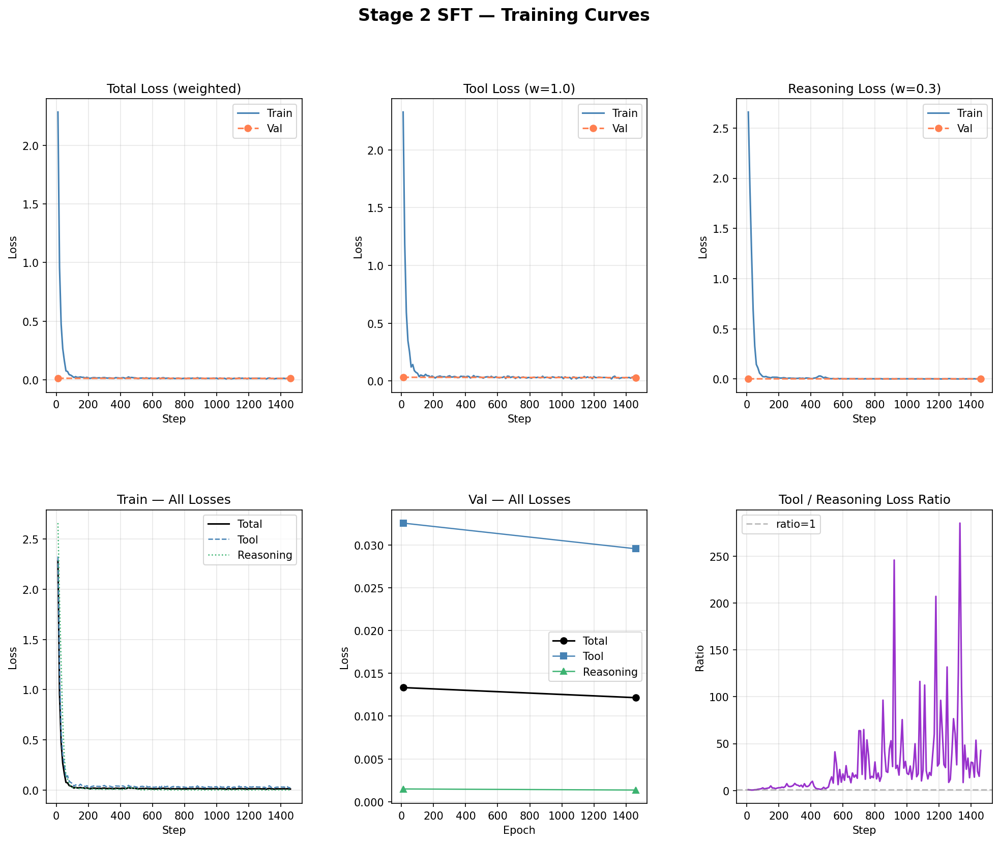

# Jarvis · Training a 3B language model to use tools

[Research report](docs/report.pdf) · [Presentation](docs/slides.pdf) · [Trained adapters](models/README.md)

Can a model that produces a valid tool call also decide which action to take next and when to stop? We studied this question with Qwen2.5-3B-Instruct in a simulated personal-assistant environment. The agent can look up contacts, check the time, schedule meetings, update a calendar, send messages, and end an episode. Each action produces feedback before the agent chooses its next step.

Supervised fine-tuning reached **94.4% tool exact match on 500 held-out examples**. Multi-step rollouts exposed a different problem. Asked for the current time, one trained policy read the clock three times before stopping. The experiments investigate how rewarding individual actions and judging a whole trajectory affect that behavior.

## Experiments

| Experiment | What was measured or observed | Evidence |
| --- | --- | --- |
| Few-shot base model | Invented tool names and missed termination in example rollouts | [Report, §2](docs/report.pdf) |
| Weighted QLoRA supervised fine-tuning | 100% format compliance and 94.4% tool exact match on the 500-example evaluation | [Evaluation summary](results/sft-evaluation.json) · [Scoring code](evaluation/stage2_evaluate.py) |
| GRPO with rule-based rewards | Average training reward across three epochs was −2.62, −2.67, and −2.49. Repeated valid actions occurred even in selected high-reward trajectories. | [Run 002 metrics](results/rule-grpo.json) · [Reward implementation](training/training_tools.py) |
| GRPO with a trajectory judge | The report gives approximate mean judge scores of 6.0, 6.7, and 7.3 out of 10. A selected scheduling example resolves the date, creates the event, and stops. | [Report, §4.3](docs/report.pdf) |

The RL runs use 41 short tasks. Judge scores are training feedback, and the two reward designs use different scales. A held-out end-to-end success rate would be needed to quantify generalization. The linked simulator defines the per-step rewards used by the included code.



## Inspect a rollout

Run this from the repository root with Python 3. It reads a saved rollout locally and displays the actions and per-step rewards.

```sh
python3 evaluation/replay.py
```

The clock example comes from the best of four sampled rollouts for that task in epoch three of run 002. In the judge-assisted example in [the report, §4.3.3](docs/report.pdf), the user asks to schedule lunch today at noon. The agent calls the clock once to resolve “today,” adds the one-hour event, and stops. The judge scored that trajectory 10/10.

## Run the experiments

Use Python 3.10 or 3.11 on a CUDA machine with BF16 support. Run all commands from the repository root. Both the policy and frozen reference occupy GPU memory during RL. First install the training environment, then prepare the tokenized split from the included synthetic examples.

```sh
python -m venv .venv
source .venv/bin/activate
pip install -r requirements.txt
python data/stage2_prepare_data.py
python training/stage2_train.py
python evaluation/stage2_evaluate.py
python training/rl_train.py --model_path outputs/stage2/adapter --tasks data/tasks.json
```

To evaluate the released SFT weights, follow the [adapter instructions](models/README.md) and place the extracted SFT adapter in `outputs/stage2/adapter/`. The evaluator reads the included raw dataset directly. It downloads the base model and a sentence encoder on first use.

## Find the implementation

| Location | Contents |
| --- | --- |
| [data](data/) | Synthetic datasets, generation and preparation scripts, and the 41 RL prompts |
| [training](training/) | Syntax-only SFT, weighted trajectory SFT, GRPO, checkpoint resume, and simulated tools |
| [evaluation](evaluation/) | Per-example tool scoring and offline trajectory replay |
| [results](results/) | Archived SFT metrics and curves, rule-based RL metrics, and a saved rollout |
| [models](models/) | Adapter provenance, download instructions, and checksums |
| [docs](docs/) | Original research report and presentation |

The archived filenames use `stage2_*` for **trajectory-augmented supervised training**. In the paper, “Stage 2” means **reinforcement learning**, implemented in `training/rl_train.py`. The original [prototype](sft.py) and [syntax examples](sft_data/) are retained for reference.
